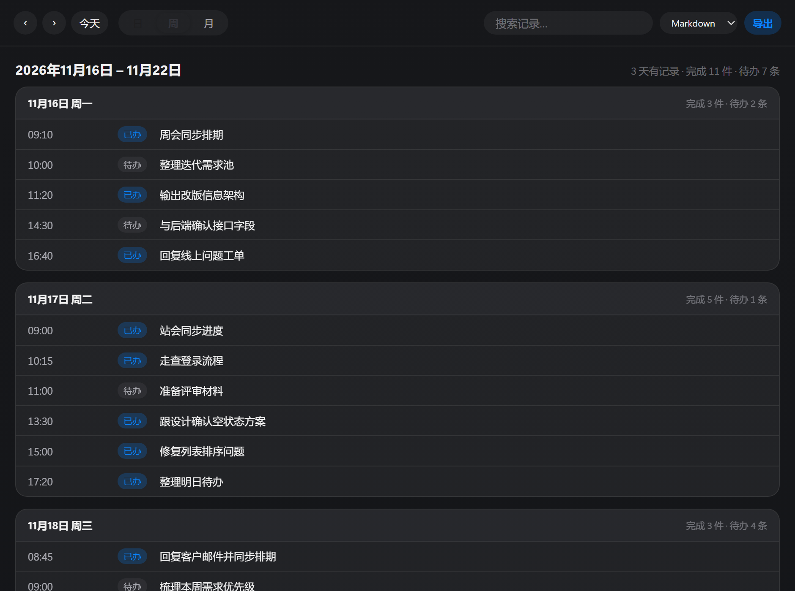
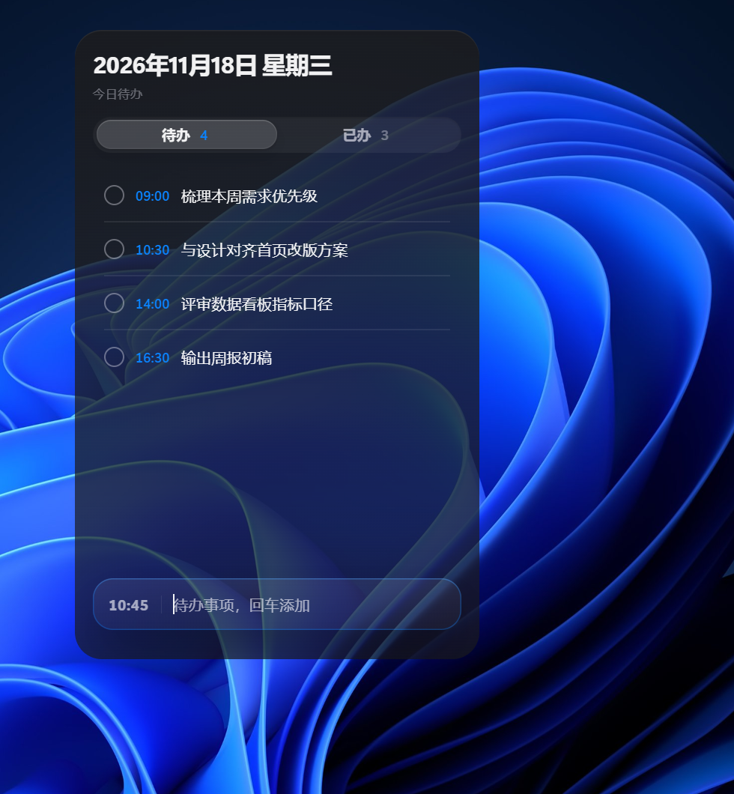

# 悬浮工作台（desktop-planner）

<p align="center">
  
</p>

Win11 桌面悬浮工作计划板：单面板悬浮窗（360×560，无边框、半透明）、贴顶自动隐藏（QQ 式）、本地 JSON（方便 AI 读写）、离线无账号。

<p align="center">
  
  &nbsp;
  
</p>
<p align="center"><sub>左：主面板（待办 / 已办、滚轮选择时间）　右：回顾（日 / 周 / 月、搜索、Markdown / CSV 导出）</sub></p>

<p align="center">
  
  &nbsp;
  
</p>
<p align="center"><sub>左：桌面悬浮（玻璃材质透出壁纸）　右：拖到屏幕顶端自动收起，仅保留顶部细边</sub></p>

## 当前状态（2026-11-18）

| 项 | 状态 |
|---|---|
| 核心功能（计划/已办/托盘/半透明面板） | 已实现 |
| 贴顶自动隐藏（QQ 式） | 收起后仅显示 104 × 4 的短细条 |
| 独立设置窗口（透明度 / 主题 / 开机自启） | 已实现（托盘右键「设置…」打开 `app/settings.html`） |
| 数据按月分片（明细永久保留） | 已实现（`months/YYYY-MM.json`，旧单文件启动时自动迁移） |
| 跨天待办与已办回顾 | 未完成待办保持可见。已办面板只显示当天，回顾按完成日期查询与导出。 |
| 时间滚轮选择（单时间点，非文本输入） | 已实现（默认当前时刻、5 分钟刻度，支持左键拖动、点击相邻数字和鼠标滚轮） |
| Obsidian Glass 视觉体系 | 已实现（玻璃分层、圆角阶梯 24/18/13、单一蓝色强调、统一阻尼动效） |
| 长事项点击展开（REQ-009） | 已实现（仅溢出时可点，行内展开/收起） |
| 主面板与回顾细节 | 已优化（已办行共享右侧空间，日回顾精简表头，托盘操作分组） |
| 数据层冒烟测试 | 已通过（`node scripts/test/smoke-datastore.js`，57 项全 PASS） |
| 覆盖安装升级（REQ-010） | 已实现（固定 appId 原地升级；数据在文档目录不受影响；迁移前备份 `workboard.v1.bak`、失败不落盘） |
| 自定义品牌图标（应用 + 托盘） | 已实现（`scripts/make-icons.py` 生成，`scripts/afterPack.js` 写入 exe） |
| NSIS 安装包流水线 | 已配置并构建（`npm run dist` → `dist\desktop-planner-Setup-*.exe`） |
| 便携版启动验收 | 已通过（本机资源管理器实测可启动，贴顶隐藏可用） |
| 全新机器安装验收 | **未完成**（安装包已构建，尚未在干净机器上做安装/卸载全流程验收） |

下文「开发 / 打包」供续做时使用；安装包需完成全新机器验收后再正式交付。

> 说明：早期版本曾使用「悬浮球」形态，现已**彻底移除**（`app/ball.html`、`app/ball.js`、`ball:*` IPC 与 `settings.ballPosition / ballDock` 均已删除），程序只保留一个 360×560 的无边框面板窗口。

## 数据位置

| 运行方式 | 数据文件 |
|---|---|
| 安装包 / 便携打包（`app.isPackaged`） | `%USERPROFILE%\Documents\悬浮工作台\workboard.json`（仅设置）+ `months\YYYY-MM.json`（每月明细） |
| 开发绿文件夹 | 项目根 `data\workboard.json`（仅设置）+ `data\months\YYYY-MM.json`（每月明细） |

`workboard.json` 只保存 `schemaVersion: 2` 与 `settings`；每天的计划/已办写入所在月份分片，月份文件按需加载。
旧版（`schemaVersion: 1`，`days` 全在根文件）启动时自动拆分到月分片。首次迁移先备份为 `workboard.v1.bak`，所有分片写入成功后才替换根文件。迁移失败时仍可查看旧记录，应用保留原文件并暂停保存，重启后重试。

## 升级（覆盖安装）

- 直接运行新版 `desktop-planner-Setup-*.exe` 即可：`appId` 固定，NSIS 会先卸旧程序文件再装新版，桌面/开始菜单快捷方式与控制面板卸载项都只有一份，不会出现两套。
- 工作数据在「文档\悬浮工作台」，与安装目录无关，覆盖安装/卸载都不删除；Chromium 缓存在 `%APPDATA%\desktop-planner\appdata`。
- 升级时**沿用原来的安装目录**。如果上一版用了默认路径，直接接受安装向导的预填路径即可。改到其他目录可能留下旧程序文件。
- 升级后请用新快捷方式启动，不要再双击旧的 1.0.0 exe（旧代码不认识 `months\` 目录，只读写根文件）。

## 开发调试

```powershell
# 首次：准备 Electron 43.3.0 到 runtime\
powershell -ExecutionPolicy Bypass -File scripts\setup-runtime.ps1

# 启动（推荐在资源管理器双击，勿在 Cursor 终端里起 Electron）
# 启动悬浮工作台.vbs  或  启动.bat
```

开发态命令（VBS/BAT 内部即为此参数，`npm start` 等价于最后一条）：

```powershell
runtime\DesktopPlanner.exe --no-sandbox "--user-data-dir=<项目>\data\appdata" "<项目>\app"
```

**本机必须的两个 Chromium 参数（缺一不可）：**

- `--no-sandbox`：本机 Chromium 沙箱初始化会崩溃（退出码 `0x80000003`），不带此参数启动不了。
- `--user-data-dir=<纯 ASCII 路径>`：默认 userData 含中文（`桌面\悬浮工作台\appdata`）时 ProcessSingleton 锁文件创建失败。打包版固定用 `%APPDATA%\desktop-planner\appdata`，开发态用项目 `data\appdata`；**Chromium 不会自动创建该目录，目录不存在时进程在进入 `main.js` 之前就退出**，VBS/BAT 与安装脚本都会预先创建。

**注意：** 在 Cursor / 部分自动化终端里启动 Electron 常会得到退出码 `-2147483645` 并秒退，属环境限制，不代表程序逻辑一定坏了。请用资源管理器双击 VBS/BAT 验证。

## 打包

```powershell
npm install --registry https://registry.npmmirror.com
npm run dist          # NSIS → dist\desktop-planner-Setup-*.exe
npm run dist:dir      # 仅解压目录 → dist\win-unpacked\
```

辅助脚本：

- `scripts/run-dist.js`：使用项目内 `.electron-cache` / `.tmp`，避开 AppData 权限问题；构建前清理上次 `.blockmap` / `latest.yml`，成功后把 `dist` 统一设为 Medium 完整性
- `scripts/afterPack.js`：用缓存里的 rcedit 把 `icon.ico` 写进 exe（`signAndEditExecutable: false` 时图标不会自动写入），再关闭 asar 完整性 fuse
- `scripts/make-icons.py`：Pillow 程序化生成应用图标（1024 PNG + 多尺寸 ICO）与托盘图标，改图标只需改这里再运行
- `scripts/make-portable.ps1`：不经 builder 改 exe，从 `runtime\` 拷贝干净便携包 → `dist\portable\`
- `scripts/installer.nsh`：安装时创建 `%APPDATA%\desktop-planner\appdata`，并给桌面/开始菜单快捷方式追加 `--no-sandbox --user-data-dir=...`

已知打包/安装坑（续做时优先看）：

1. 未签名 → SmartScreen「仍要运行」
2. NSIS 写入 `Uninstall DesktopPlanner.exe` 可能被 Defender 占用
3. builder 默认 asar integrity + `signAndEditExecutable: false` 组合曾导致进 JS 前秒退（已用 afterPack 关 fuse；便携脚本可绕过）
4. VBS 必须 ASCII，UTF-8 中文会 `800A0408 无效字符`
5. 构建结束后需把 `dist` 产物从低完整性标签统一设为 Medium（工作区曾感染低完整性标签，导致打包 exe 异常）
6. 便携版与 NSIS 安装包均已在本机验证可启动；安装包快捷方式已带上述参数，**但尚未做全新机器安装/卸载验收**
7. `runtime\`、`data\` 目录或 exe 被系统打上**低完整性标签（Low）** 时，Chromium 会因 `Lock file can not be created! Error code: 5` 在进入 `main.js` 前秒退；`启动悬浮工作台.vbs` 每次启动前会执行 `icacls ... /setintegritylevel M` 自愈，若仍失败，检查 early log（`%TEMP%\desktop-planner-early.log`）
8. 产物名必须是 ASCII（`desktop-planner-Setup-${version}.exe`）：中文名会让 NSIS 报 `Can't open output file`
9. 上一次构建的 `.blockmap` / `latest.yml` 带 Medium 标签时，再次构建会 `Access is denied`；`run-dist.js` 已在构建前自动删除
10. 图标：`signAndEditExecutable: false` 时 electron-builder 不会写 exe 图标，必须靠 `afterPack.js` 用 rcedit 写；改成 `true` 会触发 winCodeSign 解压失败

## 本地 AI 连接

从托盘打开「设置」→「AI 连接（只读）」。复制出来的配置已包含当前安装路径和数据目录。

- **Codex**：点「复制 Codex 命令」，在 PowerShell 中运行，再重新打开会话。[Codex MCP 文档](https://developers.openai.com/codex/mcp)
- **TRAE / WorkBuddy**：点「复制 MCP JSON」，把 `mcpServers` 下的 `desktop-planner` 项合并到客户端的本地 MCP 设置。已有的服务配置可保留。[TRAE 配置文档](https://docs.trae.cn/ide_add-mcp-servers) · [WorkBuddy 连接器文档](https://open.workbuddy.cn/docs/connector)

接入后可以问「列出所有未完成的待办」或「总结从 11 月 16 日到 11 月 20 日的已办」。`list_pending_tasks` 默认查询截至今天的未完成事项，`list_completed_tasks` 默认查询今天的已办。两项工具支持日期、关键词和分页。

客户端在本机通过标准输入输出启动读取进程。工作台可以关闭，连接器无需额外安装 Node.js，也不会开放网络端口。连接后，授权的 AI 客户端可以看到查询返回的任务内容。

## 功能摘要

- 主面板固定为 360×560 逻辑像素。标题区可拖动，贴顶滑动保持相同宽高，重启恢复位置。
- 贴顶自动隐藏（QQ 式）：拖到距工作区顶端 26px 内吸顶收起，只留一条 104 × 4 的短细条。悬停 90ms 后滑出（460ms），离开 650ms 后收起（400ms）。往下拖超过 46px 解除吸顶。
- Electron 托盘左键切换面板显隐，右键按「面板 / 回顾」「开机自启 / 设置」「退出」分组，首项随面板状态变化。WinForms 托盘可打开面板、回顾和设置。Esc 收起面板。
- 未完成的待办跨天保留。勾选后归到完成当天，撤销后回到原日期的待办。主面板的已办只显示当天。
- 时间只选一个点：底部时间默认当前时刻（5 分钟向上取整），点击后可左键拖动小时或分钟、点击相邻数字，或滚动鼠标滚轮；点时间、点卡片外或 Esc 收起。
- 长事项单行省略，正文溢出时可点击就地展开为多行、再点收回，不弹窗打断浏览
- 已办行的完成时间和操作按钮共享右侧栏，悬停或键盘聚焦时显示操作，正文宽度保持稳定。长事项也可用 Enter 或空格展开。
- 编辑不弹窗：原行就地变为编辑卡，时间同样用滚轮选择，正文多行自动增高，`Enter` 保存 / `Shift+Enter` 换行 / `Esc` 取消
- 删除二次确认：点删除后该行就地变为「删除这条记录？取消 / 删除」，3.5 秒无操作或点外部自动还原，不会误删
- 视觉：Obsidian Glass（玻璃材质四层叠加、圆角阶梯、单一蓝色强调），列表分隔线内缩，空状态在列表区垂直居中
- 回顾窗口按完成日期显示已办，支持日 / 周 / 月切换、左右方向键翻页、关键字搜索和 Markdown / CSV 导出。
- 逐像素透明窗口：透明度由 CSS 决定，失去焦点仍保持透明；圆角 24px 由 CSS 绘制（无磨砂模糊、无 DWM 阴影）
- 数据原子写 + 外部修改自动重载

## 目录结构

```
desktop-planner/
├─ app/                      应用本体
├─ scripts/                  setup / 托盘宿主 / 图标 / 打包辅助
├─ package.json              electron-builder 入口
├─ docs/ai-team/             需求与设计
├─ dist/                     构建产物（不入库）
├─ runtime/                  开发用 Electron（不入库）
└─ data/                     开发态数据（不入库）
```

更细的架构与 ADR 见 [docs/ai-team/design.md](docs/ai-team/design.md)；需求条目见 [docs/ai-team/requirements.md](docs/ai-team/requirements.md)；**UI 改动前必读** [docs/ai-team/design-system.md](docs/ai-team/design-system.md)（视觉令牌、组件、动效、禁止清单与自检表）。
